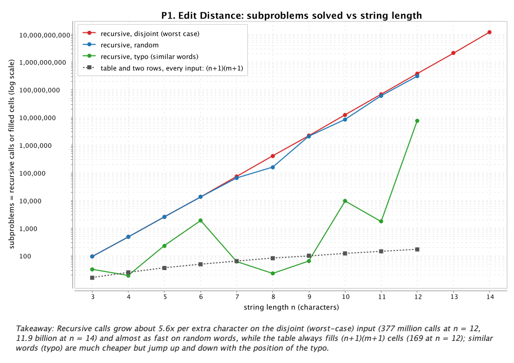
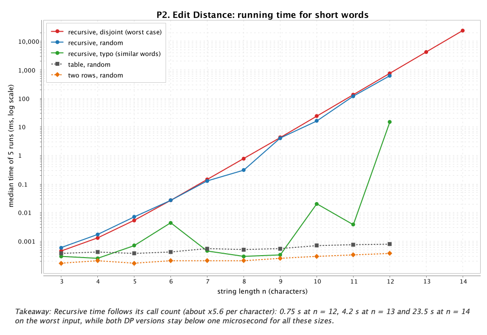
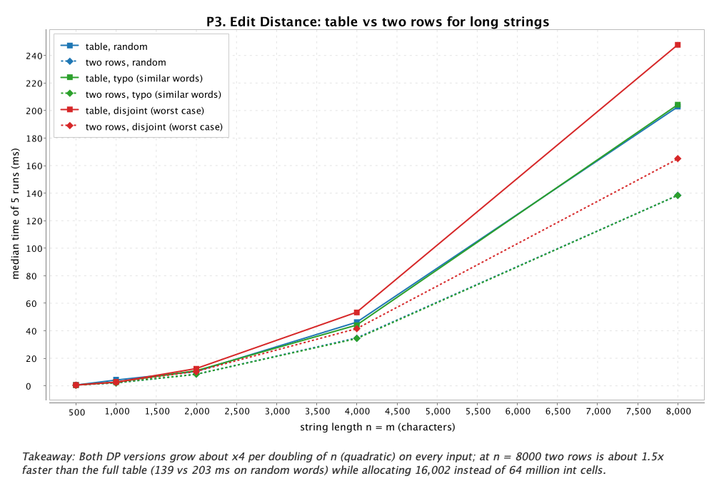
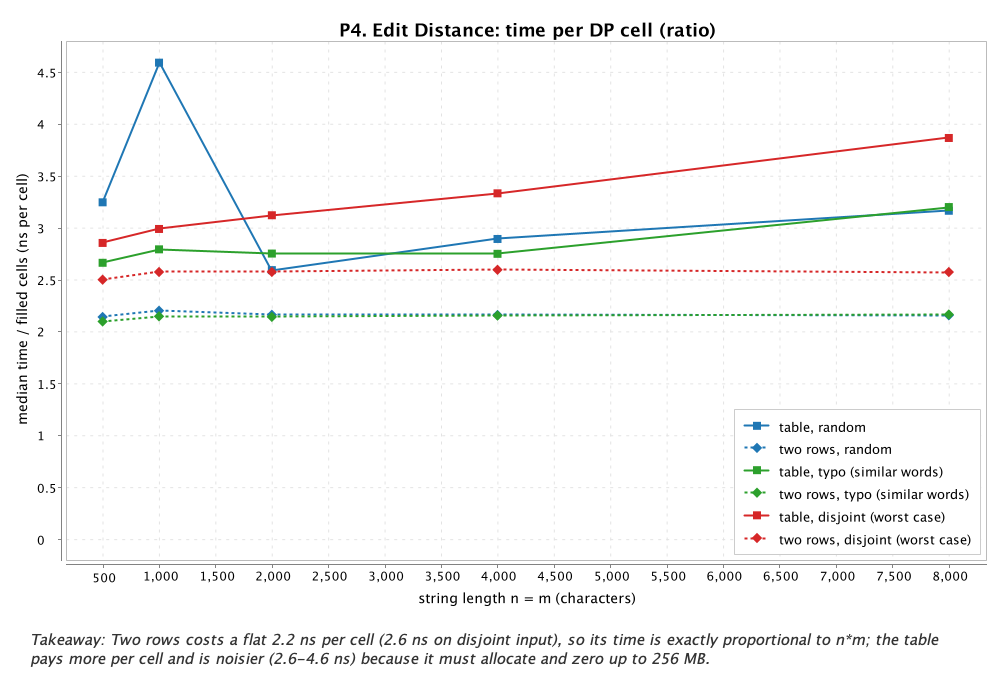
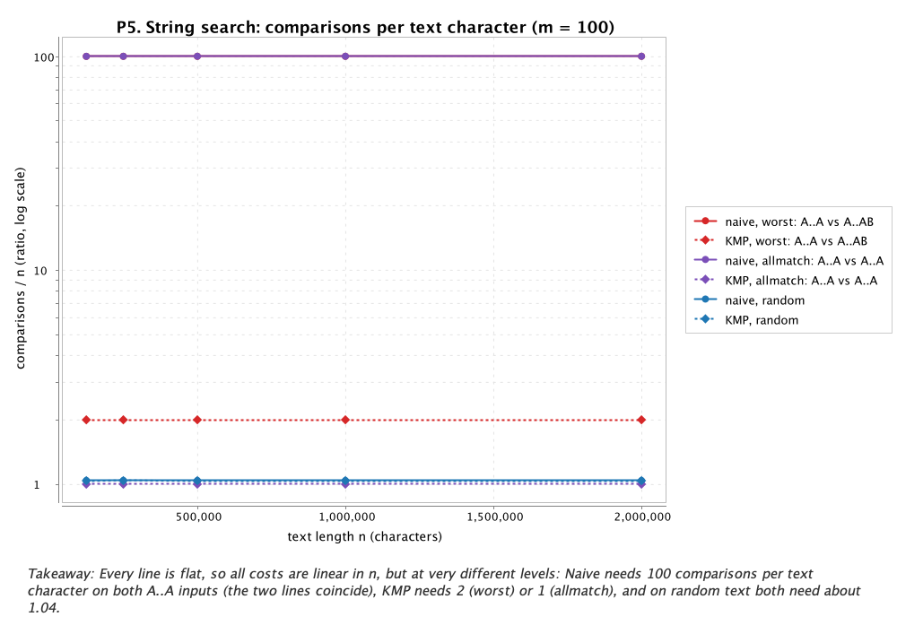
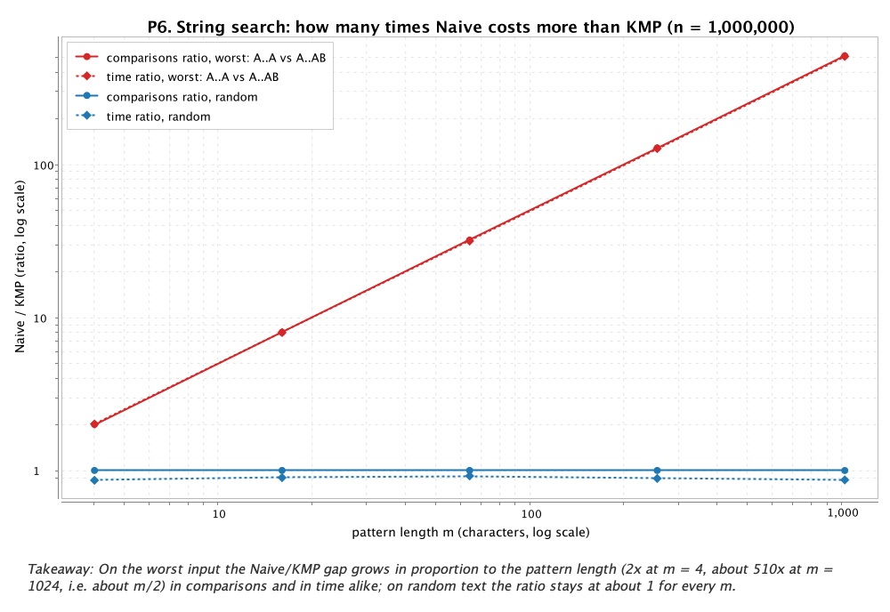
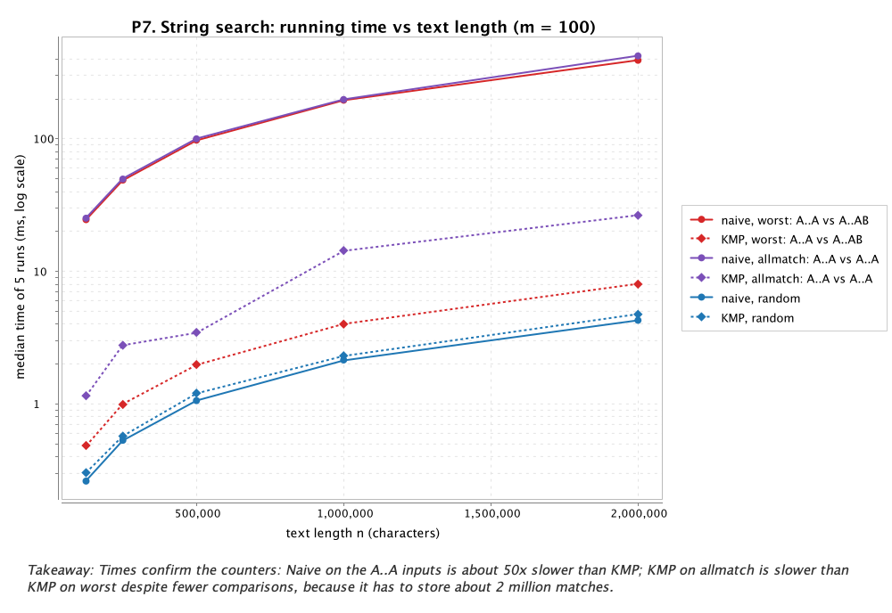

# Assignment 4 — Dynamic Programming and String Algorithms

City Search & Spell-Check: how different are two words (Edit Distance), and where does a
pattern appear in a long text (Naive vs KMP)?

## 1. Experiment Design Card

Written **before the first run** (see the git history: this card is committed before
`results/results.csv` exists). Changes made after the first run are listed in 1.1.

| Field | Edit Distance (recursive, table, two rows) | String Search (Naive, KMP) |
|---|---|---|
| **Question** | Does plain recursion really repeat work exponentially, and do the table and two-row versions grow exactly like n·m, with two rows saving memory but not time? | Does Naive fall to n·m work on an adversarial input while KMP stays linear (≤ 2n comparisons) on every input, and how large is the gap in practice? |
| **Sizes (n)** | **E1** (all three versions): n = 3, 4, …, 12. Recursion grows roughly like 5.8ⁿ, so 12 is the largest size I expect to finish in a few seconds; the DP versions run on the same sizes so all three can share one plot. **E2** (table, two rows): n = 500, 1000, 2000, 4000, 8000 (×16). 8000² = 64 M cells, the table then needs 256 MB, which still fits into the default heap. Both strings have length n (typo input: about n). | **S1** (vary the text): n = 125 000, 250 000, 500 000, 1 000 000, 2 000 000 with m = 100 (×16). **S2** (vary the pattern): n = 1 000 000 with m = 4, 16, 64, 256, 1024 (×256), to see the effect of pattern length alone. |
| **Inputs** | **random** — two unrelated words over a–z: the average case. **typo** — b is a copy of a with 1 + n/10 random substitutions, insertions or deletions: the real spell-check case; similar strings are the best realistic case for recursion, because equal last characters lead to only one recursive call. **disjoint** — a uses only a–m, b only n–z: no character ever matches, so every recursive call branches three ways — the **worst case** for recursion. | **random** — a–z text, pattern cut out of the text (at least one match): typical search, most windows fail on the first character. **worst** — T = Aⁿ, P = A^(m−1)B: every window matches m−1 characters and then fails — the **worst case** for Naive. **allmatch** — T = Aⁿ, P = Aᵐ: every position is an overlapping match; it checks overlap handling under load and also costs Naive m comparisons per window. |
| **Metrics** | `time_ms`: median of 5 runs after 2 warm-up runs — the real cost on this laptop. `subproblems`: recursive calls (A) or filled cells (B, C) — machine-independent work, shows repeated work directly. `comparisons`: character comparisons. `cells_allocated`: ints of DP storage — the memory that two rows should save. `max_depth`: recursion depth (stack use). `result`: the distance, to check that the versions agree inside the experiment too. | `time_ms`: same method. `comparisons`: text-vs-pattern character comparisons — the textbook cost unit. `lps_comparisons`: KMP preprocessing cost (≤ 2m). `backsteps`: how often the text pointer moved backwards (KMP must show 0). `result`: number of matches, to check that both agree. |
| **Prediction** | Recursive `subproblems` multiply by about 5–6 per +1 of n on disjoint input — a straight rising line on a log axis. Random looks almost the same (random letters match with probability 1/26). Typo is far below, but noisy: only the misaligned branches explode, and how much depends on where the typo is. Table and two rows: exactly (n+1)(m+1) cells for every input, time ×4 per doubling of n, so time per cell is flat. Two rows: the same speed or slightly faster (two short rows stay in the cache) and 2(m+1) cells instead of (n+1)(m+1). Recursion should stop being practical at about n = 12–13. | random: both ≈ 1.04·n comparisons and nearly equal times (Naive may even be a little faster: simpler loop, no LPS). worst and allmatch: Naive ≈ (n−m+1)·m ≈ 100·n comparisons, KMP ≈ 2n (worst) and ≈ n (allmatch), so 50–100× fewer comparisons and a time gap of the same order. S2: on the worst input the Naive/KMP ratio grows linearly with m (≈ m/2); on random input it stays ≈ 1. |
| **Plots** | **P1** subproblems vs n, log y: does recursion repeat work exponentially while DP stays polynomial? **P2** time vs n, log y: how large an n can recursion handle? **P3** time vs n for table and two rows: is the growth quadratic, and which version is faster? **P4** time per cell vs n (ratio): is the cost exactly proportional to n·m? | **P5** comparisons vs n, log–log, one line per algorithm and input: which input blows Naive up? **P6** Naive/KMP ratio of comparisons and of time vs m, log x: how does the pattern length change the gap? |

**Reproducibility.** Every input is produced by `daa.experiment.InputGenerator` with
`java.util.Random` and a seed derived from the fixed base seed `20261108` and the
configuration (experiment, input, n, m). The same command gives the same inputs and the same
counters; only the times depend on the machine.

### 1.1 Changes after the first run

1. **Added a recursion limit probe (E1L):** recursive version, disjoint input, n = 13 and 14,
   3 measured runs and no extra warm-up. Reason: in the first run n = 12 took only 0.75 s, so
   the prediction "practical limit ≈ 12–13" could not be checked from the data. One run at
   n = 14 takes about 23 s, so I used the allowed minimum of 3 runs.
2. **P5 changed and P7 added.** P5 now shows comparisons *per text character* (a ratio) instead
   of raw comparisons on log–log axes: the plotting library could not label a log x-axis between
   125 000 and 2 000 000 readably, and flat lines answer "is it linear, and with which constant?"
   more directly. P7 (search time vs n) was added so that the search family also has a plain
   time plot next to its counters.
3. **`time_ms` precision** raised from 4 to 6 decimals, because the DP versions at n ≤ 12 run
   in under 1 µs and were rounded to a few steps.

## 2. Setup and counters

* **Machine:** MacBook Air M2, 8 GB RAM, macOS, OpenJDK 25.0.1, one JVM started by
  `mvn -q compile exec:java` (whole run: 137 s, 856 CSV rows).
* **Method:** each configuration generates its input once (seeded), runs every algorithm on
  that same input 2 times as warm-up (not recorded) and then 5 measured times
  (`System.nanoTime()` around one call). Every measured run is one row in `results.csv`; the
  plots use the median. A global JIT warm-up runs before everything.
* **Why these counters.** `subproblems` counts each evaluation of D(i, j): a recursive call
  in version A, a filled cell in B and C. It is exactly the thing recursion repeats, so it
  shows the repeated work directly and puts all three versions on the same scale.
  `cells_allocated` is the memory question of the two-row version. For string search,
  `comparisons` is the textbook cost unit (the bounds (n−m+1)·m and 2n are stated in
  comparisons). `lps_comparisons` adds KMP's preprocessing so the comparison is fair, and
  `backsteps` checks KMP's key property, that it never moves back in the text. All counters
  are increased inside the algorithms (see `EditCounters`, `SearchCounters`).
* **Correctness inside the experiment:** the runner stops if two versions return a different
  distance or a different match list. This never happened.
* **Reproducibility check:** two separate full runs gave identical counters for all 170
  configurations of E1, E2, S1 and S2; only the times differed slightly.

## 3. Plots and results

Every PNG also has its one-sentence takeaway printed under the chart.

<table>
<tr>
<td width="50%"></td>
<td width="50%"></td>
</tr>
<tr>
<td><b>P1 (log y).</b> Recursive calls grow ≈ 5.6× per character on the worst input
(377 M at n = 12, 11.9 billion at n = 14), random is almost as bad, while the table always fills
(n+1)(m+1) = 169 cells at n = 12; typo inputs are cheap but jump with the typo position.</td>
<td><b>P2 (log y).</b> Recursive time follows its call count: 0.75 s at n = 12, 4.2 s at
n = 13, 23.5 s at n = 14, while both DP versions stay below 1 µs at these sizes.</td>
</tr>
<tr>
<td></td>
<td></td>
</tr>
<tr>
<td><b>P3.</b> Both DP versions grow ≈ 4× per doubling of n (quadratic) on every input; at
n = 8000 two rows is ≈ 1.5× faster than the table (139 vs 203 ms on random words).</td>
<td><b>P4 (ratio).</b> Two rows costs a flat 2.2 ns per cell (2.6 ns on disjoint input), so its
time is exactly ∝ n·m; the table pays more per cell (2.6–4.6 ns) and is noisier.</td>
</tr>
<tr>
<td></td>
<td></td>
</tr>
<tr>
<td><b>P5 (ratio, log y).</b> All lines are flat (linear in n) but at different levels: Naive
needs 100 comparisons per character on both A…A inputs, KMP 2 (worst) or 1 (allmatch), and both
≈ 1.04 on random text.</td>
<td><b>P6 (ratio, log–log).</b> On the worst input the Naive/KMP gap grows with the pattern
length (2× at m = 4 → ≈ 510× at m = 1024, i.e. ≈ m/2), in comparisons and in time alike; on
random text it stays ≈ 1.</td>
</tr>
<tr>
<td></td>
<td><b>P7 (log y).</b> Times confirm the counters: Naive on the A…A inputs is ≈ 50× slower
than KMP. KMP on allmatch is slower than KMP on worst although it makes fewer comparisons,
because it has to store ≈ 2 million matches.</td>
</tr>
</table>

**Key numbers** (medians; counters are exact and identical in every run):

| Edit Distance, n = m = 8000 | table | two rows |
|---|---|---|
| filled cells (`subproblems`) | 64 016 001 | 64 016 001 |
| `cells_allocated` (memory) | 64 016 001 ints ≈ 256 MB | 16 002 ints ≈ 64 KB |
| time random / typo / disjoint | 203 / 204 / 248 ms | 139 / 138 / 165 ms |

| String search, n = 2 000 000, m = 100 | Naive comparisons | Naive time | KMP comparisons (+LPS) | KMP time | backsteps Naive / KMP |
|---|---|---|---|---|---|
| random | 2 079 916 | 4.3 ms | 2 076 879 (+102) | 4.7 ms | 2 912 / 0 |
| worst (A…A vs A…AB) | 199 990 100 = (n−m+1)·m | 390 ms | 3 999 901 = 2n−m+1 (+197) | 8.0 ms | 1 999 900 / 0 |
| allmatch (A…A vs A…A) | 199 990 100 | 420 ms | 2 000 000 = n (+99) | 26.3 ms | 1 999 900 / 0 |

## 4. Prediction vs result

**Edit Distance.**

* *Recursion, as predicted:* on disjoint input the call count grew by 5.1× per character at
  n = 4, rising to 5.62× at n = 14 (the theoretical limit for this recurrence is
  3 + 2√2 ≈ 5.83). Random words gave exactly the same counts up to n = 6 (no chance matches in
  such short words) and up to 18 % fewer calls at n = 12 (308 M vs 377 M), with small jumps
  when a chance match occurs near the end of the words. Typo input was far cheaper and very
  noisy, as predicted: 23 calls at n = 8 but 7.5 M at n = 12. The reason is that equal last
  characters cost one call, so the recursion runs cheaply along the diagonal until it meets
  the typo; from there the misaligned branches explode on the remaining prefix. A typo near the
  end of the word is therefore expensive and a typo near the start is almost free.
* *DP, as predicted:* both versions filled exactly (n+1)(m+1) cells on every input, and the
  time grew ≈ 4× per doubling (two rows: 34.7 → 138.6 ms from n = 4000 to 8000, ×3.99).
* *Surprise 1: two rows was clearly faster, not "the same or slightly faster".* It took
  0.48–0.88 of the table time (≈ 0.68 at n = 8000) with identical cell and comparison counts.
  In Java, `int[n+1][m+1]` is n+1 separate arrays: the table version must allocate and zero up
  to 256 MB, and every new row is cold in the cache. The two rows (2 × 32 KB) stay in the
  cache. The cost difference is memory traffic, which my work counters do not count, but
  `cells_allocated` shows it.
* *Surprise 2: the input type changed the time per cell, although the counters are the same.*
  Disjoint input was ≈ 20 % slower per cell (2.6 vs 2.2 ns for two rows). I did not profile
  this. A likely reason is that on disjoint input every cell takes the `1 + min(...)` branch,
  which waits for the cell just computed on its left. Random input has ≈ 4 % matching cells
  that only copy `prev[j−1]` and break this chain.
* *Recursion limit:* I predicted 12–13. Measured: 0.75 s at 12, 4.2 s at 13, 23.5 s at 14, so
  the limit is 13–14 depending on how long one is willing to wait.

**String search.**

* *Random text, as predicted:* both made 1.04 comparisons per character, and Naive was ≈ 10 %
  faster (time ratio 0.9). It has the simpler loop and no LPS array.
* *Worst input, as predicted:* Naive made exactly (n−m+1)·m comparisons and KMP exactly
  2n−m+1, a ratio of 50.0, and the time ratio was 48.9–50.6.
* *S2, as predicted:* the comparison ratio was 2.0, 8.0, 32.0, 128.0, 511.2 for
  m = 4…1024 (≈ m/2), and the time ratio was 2.0, 8.0, 31.6, 126.7, 506.4. On random text both
  ratios stayed ≈ 1.
* *Surprise: allmatch.* The comparison ratio was 100 as predicted (KMP needs exactly n), but
  the time ratio was only 14–29×. Both algorithms must store ≈ 2 million positions in an
  `ArrayList<Integer>`, which means one `Integer` object per match plus array growth. This
  output cost is the same for both and is much larger than KMP's 2 M comparisons. It also made
  the KMP-allmatch times the noisiest in the whole experiment (up to 13× between runs), most
  likely because of garbage collection.
* *KMP property:* `backsteps` was 0 in every KMP run, while Naive moved back once per window on
  the A…A inputs (1 999 900 times).

## 5. Short answers

**Which input made your string search slowest, and why?** The adversarial input T = A…A with
P = A…AB (and equally A…A with P = A…A) was slowest. For n = 2 000 000 and m = 100 Naive
needed 199 990 100 comparisons and 390 ms, compared with 2.08 M comparisons and 4.3 ms on random
text. In every window the first m−1 characters match, so Naive does all m comparisons, then
shifts by one and re-reads m−1 of the same characters (the `backsteps` counter shows one
backward move per window). Its cost is (n−m+1)·m, and it gets worse with longer patterns: at
m = 1024 Naive was 506× slower than KMP. KMP's own slowest case in comparisons was also the
worst input (2n−m+1, because after each mismatch it falls back via LPS and compares the same
text character once more). In time, KMP was slowest on allmatch, because storing 2 million
results costs more than its comparisons.

**How large an n could the recursive Edit Distance handle, and what stopped it?** On the worst
input it handled n = 12 in 0.75 s, n = 13 in 4.2 s and n = 14 in 23.5 s (11.9 billion calls).
Each extra character multiplies the work by ≈ 5.6, so n = 15 would take about 2 minutes and
n = 20 several days. Time stopped it, not memory: the recursion is only n+m = 28 frames deep,
nowhere near a stack overflow. The problem is that at n = 14 there are only 15 × 15 = 225
different subproblems, but they are recomputed ≈ 53 million times each, because nothing is
stored. A real street name like "Abylai Khan" (11 characters) already costs about 0.1 s per
comparison with recursion, while the table answers in under a microsecond.

**What do you gain and what do you lose when you use two rows instead of the full table?** You
gain memory: 2(m+1) instead of (n+1)(m+1) ints, which at n = 8000 is 16 002 cells (≈ 64 KB)
instead of 64 million (≈ 256 MB), so much longer strings fit. In my runs it was also 1.1–2×
faster, because the two rows stay in the cache and nothing large has to be allocated. The
number of computed cells, O(n·m), stays exactly the same. You lose the table itself: without
it you cannot trace back *which* insertions, deletions and replacements give the distance. A
"Did you mean …?" feature that highlights the changed letters needs the table, or a cleverer
method such as Hirschberg's algorithm. The code is also slightly more fiddly (row swap,
per-row base case).

**If you had to choose one string search for your city platform, which one and why?** I would
choose KMP. On normal text it is as fast as Naive (within ≈ 10 %, both ≈ 1.04 comparisons per
character), but its cost is guaranteed: at most 2n comparisons plus 2m for the LPS array,
whatever the input. Operators search log files, which are full of repetition (repeated
prefixes, long runs of the same character, repeated lines). That is exactly where Naive slowed
down 50× (m = 100) to 500× (m = 1024), and a user-typed pattern could even trigger this on
purpose. KMP also never moves back in the text, so it can scan a huge log as a stream, chunk by
chunk, without keeping old text in memory. The small cost on random text is cheap insurance.

## 6. One paragraph on time

The measured times were stable: the median spread (slowest / fastest of the 5 runs, for configurations above 1 ms) was only
1.03×, and they followed the counters closely. For example, the Naive/KMP time ratios on the
worst input (2.0, 8.0, 31.6, 126.7, 506.4) almost equal the comparison ratios (2.0, 8.0, 32.0,
128.0, 511.2). Still, times are not my only evidence, for three reasons. First, they depend on
this laptop, the JDK and the JIT compiler: on another machine every millisecond changes, while
the counters stay identical because the inputs come from a fixed seed. Second, the clock also
measures things that are not the algorithm: garbage collection and allocation (KMP on allmatch
varied up to 13× between runs, and the table paid for zeroing 256 MB), and cache effects (two
rows beat the table with exactly the same number of cells). Third, for tiny inputs (the DP
versions at n ≤ 12 take 0.2–0.8 µs) the clock resolution is close to the value being measured.
So I use the counters to say *how much work* an algorithm does, and the times to check that
this work really turns into seconds and to find the cases (memory, output size) where it does
not.
